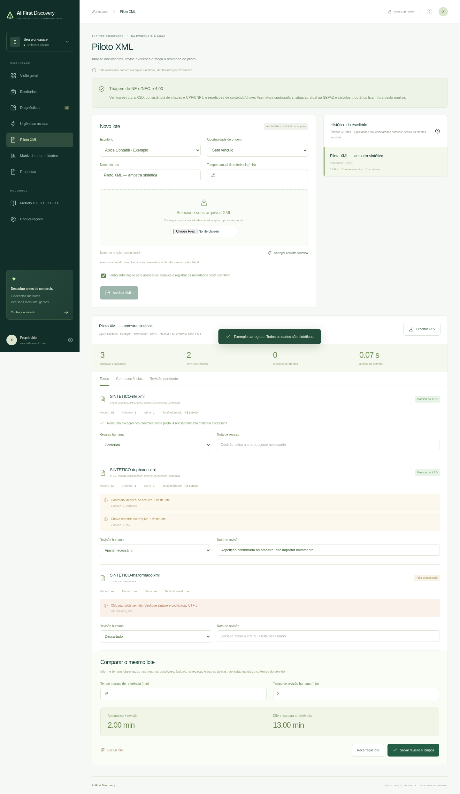

# Validação da primeira versão

Executada em 18/10/2026 com Node.js 24.19.0 e build de produção do Next.js 16.4.0. Dados de teste sintéticos, sem dados fiscais reais.

| Verificação | Resultado |
| --- | --- |
| `npm test` | 12 testes passaram |
| `npm run build` | Build de produção concluído |
| Navegador Chromium, 1440 × 1100 | Login, exemplo, catálogo com 64 hipóteses, busca, cadastro/edição, persistência após reload, entrevista, bloqueio de piloto, CSV e geração de proposta passaram |
| Navegador Chromium, 390 × 844 | Navegação e menu móveis passaram; sem overflow horizontal da página |
| HTTP: `/api/data` e `/api/export` sem sessão | Retorno 401 |
| HTTP: mutação autenticada com origem externa | Retorno 403 |
| HTTP: piloto sem gates | Retorno 400 |
| HTTP: exclusão de escritório com registros vinculados | Retorno 400 |
| HTTP: exportação autenticada | JSON versão 1 gerado |
| HTTP: sessão após logout | Acesso revogado, retorno 401 |
| Pacote de entrega | Sem credenciais, banco de teste ou dependências vendorizadas |

Os testes automatizados verificam também a integridade entre escritórios, bloqueio de mudança de escritório com dependências, conflito de edição, hash scrypt, tokens de sessão protegidos por hash e limitação de tentativas de login. As capturas mostram somente dados fictícios.

O workflow de CI repete os testes e o build no GitHub. A publicação real na VPS não foi executada: o acesso à administração de VPS da Hostinger não estava disponível nesta sessão.

## Desktop

## Celular

## Preparação para VPS

- Build Docker multi-stage concluído, incluindo os 12 testes e build standalone.
- Docker Compose validado com configuração sintética.
- Caddyfile validado pelo Caddy 2, com redirecionamento HTTP → HTTPS automático. Nenhum certificado para o domínio real foi solicitado neste teste.
- Imagem executada como UID 1000, com acesso sem login bloqueado e login autenticado funcional.
- Registro gravado no volume e consultado pela API após reiniciar o contêiner.
- Assistente de configuração testado em terminal: confirmação de senha, entrada oculta, hash scrypt e arquivo com permissão 600.

Destino informado pelo usuário: `discovery.eltonrosa.site`, em VPS Hostinger. DNS, serviços existentes e portas precisam ser inspecionados no servidor antes da implantação.

## Piloto de XML fiscal

- 12 testes Node.js e 7 testes Python passaram; build de produção concluído.
- Imagens Docker da aplicação e do analisador construídas e executadas com sucesso.
- Integração em navegador e HTTP: amostras sintéticas, validação XSD, CNPJ numérico e alfanumérico, duplicidades no lote e no histórico por escritório, revisão persistida, comparação de tempos, CSV e JSON passaram.
- APIs sem sessão retornaram 401; origem externa foi bloqueada com 403; exclusão de escritório com lote vinculado foi bloqueada.
- Tela móvel de 390 px sem overflow horizontal ou erros JavaScript.
- XML original não consta na persistência nem na exportação. A análise não valida assinatura criptográfica nem consulta a situação atual na SEFAZ.

Detalhes e limites: [Piloto XML](piloto-xml.md).

