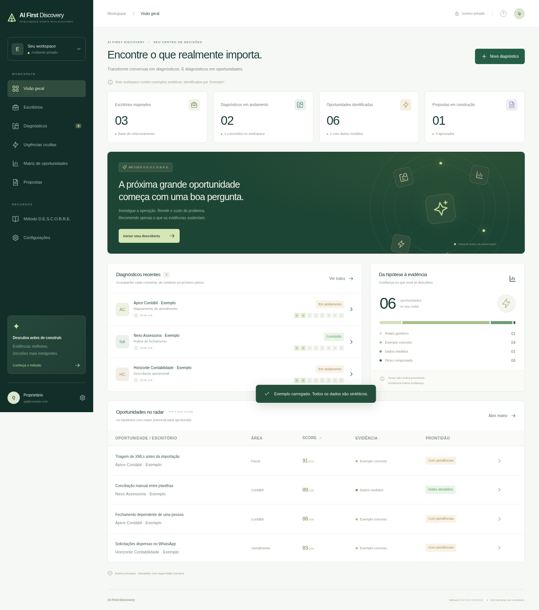
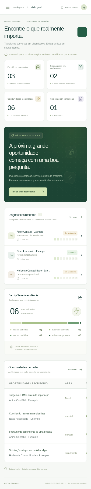

# Validação da primeira versão

Executada em 18/10/2026 com Node.js 24.19.0 e build de produção do Next.js 16.4.0. Dados de teste sintéticos, sem dados fiscais reais.

| Verificação | Resultado |
| --- | --- |
| `npm test` | 10 testes passaram |
| `npm run build` | Build de produção concluído |
| Navegador Chromium, 1440 × 1100 | Login, exemplo, catálogo com 64 hipóteses, busca, cadastro/edição, persistência após reload, entrevista, bloqueio de piloto, CSV e geração de proposta passaram |
| Navegador Chromium, 390 × 844 | Navegação e menu móveis passaram; sem overflow horizontal da página |
| HTTP: `/api/data` e `/api/export` sem sessão | Retorno 401 |
| HTTP: mutação autenticada com origem externa | Retorno 403 |
| HTTP: piloto sem gates | Retorno 400 |
| HTTP: exclusão de escritório com registros vinculados | Retorno 400 |
| HTTP: exportação autenticada | JSON versão 1 gerado |
| HTTP: sessão após logout | Acesso revogado, retorno 401 |
| Pacote de entrega | Sem credenciais, banco de teste ou dependências vendorizadas |

Os testes automatizados verificam também a integridade entre escritórios, bloqueio de mudança de escritório com dependências, conflito de edição, hash scrypt, tokens de sessão protegidos por hash e limitação de tentativas de login. As capturas mostram somente dados fictícios.

Publicação hospedada não verificada: auxiliares e starter do Sites ausentes no ambiente. O workflow de CI foi incluído para repetir os testes e o build no GitHub; seu resultado remoto deve ser consultado no pull request.

## Desktop

## Celular

